# Preflight AI

Ask questions about aircraft maintenance issues in plain English and get answers backed by the records.

All data is made up: 12 demo aircraft, 180 issues, 480 tasks and their history, generated from a seed, plus 60 scanned-looking coordination documents. The model can only read them through eight read-only tools, and every answer shows which records and passages it used. Nothing here is a real maintenance system.

**Live demo:** <https://preflight-oss-demo.preflight-ai.workers.dev> runs this repository's code with Claude Sonnet 4.6 on Amazon Bedrock.



## Use it with your own data

Nothing in the architecture is tied to aircraft. The chat UI, the model loop, the answer checks and the hosting work with any records you can put in PostgreSQL and reach through read-only tools. To build your own version:

1. **Data.** Replace the tables in `sql/schema.sql` and the CSVs that `scripts/load_postgres.py` loads. Documents for search load through `scripts/load_documents.py`.
2. **Tools.** Write each query in `mcp_service/repository.py` and expose it as a tool in `mcp_service/server.py`. Give it a typed result in `preflight_core/models.py` and an entry in `preflight_core/tools.py`. The model can see only what these tools return.
3. **Prompt and checks.** Rewrite what the model is told about your subject in `backend/prompts.py`, and change `ID_FORMAT` in `preflight_core/scope.py` to match your record IDs, so the tool schemas and the answer checks recognize them.
4. **Filters and evaluation** (optional). The scope filters live in `preflight_core/scope.py` and `frontend/src/scope-options.json`. Questions scored against your own SQL go in `evals/`.

Keep the tools read-only and the database private, so the chat endpoint stays the only public entry.

## What is in the repo

- **Chat UI** in React, served with a small proxy that holds the only credential. The browser never sees a key.
- **API** in FastAPI: a streaming chat endpoint, one answer at a time, with fixed limits.
- **Eight read-only tools** over MCP: aircraft summary, open issues, issue history, counts grouped by subsystem, priority, status or aircraft (zeros included, with an optional date window), a comparison of several aircraft, issue search with filters, task lists by status, kind, team and aircraft, and document search. SQL does the arithmetic; each result is validated and its record IDs are kept as evidence.
- **Scanned documents**: 60 fictional policies, handovers, memos, meeting notes and forms, rendered as office scans ([sample](docs/scans/handover-DOC-0011.jpg)) and read back with OCR. Their passages are searched by keyword and by meaning (a local embedding model in PostgreSQL with pgvector), combined; see [the retrieval evaluation](docs/RETRIEVAL_EVALUATION.md).
- **Scope filters** in the chat: pick a record type, aircraft, team, status, kind, priority or date window, and every answer stays inside that view. The selection travels as structured data, not as text in the question; the server fills it into each tool call, refuses calls that contradict it, and withholds results outside it. A filter can also prepare an editable question, the page warns when the question names a different aircraft or status, and each answer shows the scope it used. Filters live in the URL, so a view can be shared.
- **PostgreSQL** with the generated fictional data, loaded in one checked transaction, read-only roles.
- **Model choice** with one setting: Claude or OpenAI with your own key, or GitHub Copilot.
- **Three runtimes.** The Copilot SDK's loop, or this repository's own loop over the Anthropic API: multi-step and parallel tool calls, every result validated, and the record IDs and numbers in the answer checked against the tool results before it is marked complete. The same loop also runs as a LangGraph graph (`CHAT_RUNTIME=langgraph`); both pass the same tests and scored the same on the evaluation.
- **Tracing** with OpenTelemetry, off unless an endpoint is set: one span per answer, tool call and model call, with tokens, timings and verification, never the question or answer text. A Jaeger viewer runs locally with `--profile observability`.
- **Hosted demo**: Cloudflare Workers serves the UI and forwards chat to this stack on a single AWS host. The model is Claude on Amazon Bedrock, reached through the host's IAM role, so no model key is stored anywhere. The tools go through Amazon Bedrock AgentCore Gateway, which reaches the MCP service over a private network path; the MCP service has no public listener. A daily answer cap bounds the cost.
- **Evaluation** with original questions scored against SQL (`evals/`): a 22-case tuning set used to improve the prompt and verifier, a fresh 22-case held-out set written without seeing model outputs, and two earlier held-out sets that have since informed changes (`evals/seen/`). With Claude Sonnet 4.6 on Bedrock through the Gateway, three runs of the newest held-out set passed 18, 18 and 19 of 22 strict checks, and 21 of 22 answers contained the expected records and numbers in each run; after the fixes it pointed to (zero-count groups and a tool-choice hint), three more runs passed 21, 21 and 19. A model comparison on the same sets (three runs each) put Claude Sonnet 5.5 at 21 to 22 of 22 on tuning and 19 to 21 on held-out, at about 1.3 cents an answer, against 2.1 cents for Sonnet 4.6; Claude Haiku 5.5 scored close to Sonnet 4.6 for under 0.1 cent. On a 22-question document set (three runs), every answer contained the expected facts and cited the right documents; after two fixes that set found in the verifier, 19 to 21 of 22 also passed every strict check. A 12-question scoped set asks questions inside a selected view, four of them trying to step outside it; six runs on the demo passed 12, 12, 12, 12, 10 and 12 of 12, and no answer left the view. Two security sets test the boundary: 12 prompt-injection cases (direct requests, a forged history turn, and records whose text carries instructions) and 8 tool-outage cases run behind a proxy that makes tools fail. Across Sonnet 4.6, Sonnet 5.5 and Haiku 5.5, no answer followed an injected instruction, and every outage was reported rather than filled in. `scripts/eval_summary.py` combines repeated runs.
- **Setup notes and the data contract** in `docs/`.

## Run it locally

You need Docker Compose v2 and one model credential: an Anthropic or OpenAI key, or a GitHub token with Copilot access. No cloud account is needed.

```sh
python3 -B scripts/init_secrets.py
# put your key in .secrets/model-api-key   (Copilot: .secrets/copilot-token and MODEL_PROVIDER=copilot)
docker compose build
docker compose up -d --wait
python3 -B scripts/load_postgres.py --container preflight-oss-postgres --database preflight_oss
python3 -B scripts/load_documents.py --container preflight-oss-postgres --database preflight_oss
python3 -B scripts/compose_check.py          # health, row counts, tools against SQL
python3 -B scripts/compose_check.py --ask    # one real answer, checked against SQL
open http://127.0.0.1:8080
docker compose down -v
```

Only the web entry is published, on port 8080. The database and the tool service stay private. Options, the OpenAI and Copilot variants and the workspace setting for user-scoped Anthropic keys are in [docs/SETUP.md](docs/SETUP.md).

## Tests

```sh
cd frontend && npm ci --ignore-scripts && npm test && npm run build && cd ..
uv venv .venv --python 3.14
uv pip sync --python .venv/bin/python --require-hashes requirements-dev.txt
.venv/bin/python -B -W error -m unittest discover -s tests -v
.venv/bin/ruff check backend mcp_service preflight_core scripts tests
.venv/bin/mypy
```

These use fixtures and a fake model client. The stack check above is the real thing.

## Where it is going

- A fresh held-out set, since the current one has now informed fixes.
- Claude Sonnet 5.5 for the hosted demo once it is available on the demo's Bedrock account.

[Design](docs/DESIGN.md) · [Setup](docs/SETUP.md) · [Data contract](docs/DATA_CONTRACT.md)

## License

MIT. See [LICENSE](LICENSE). Third-party notices for bundled frontend dependencies are kept in `frontend/public/THIRD_PARTY_NOTICES.txt`.
